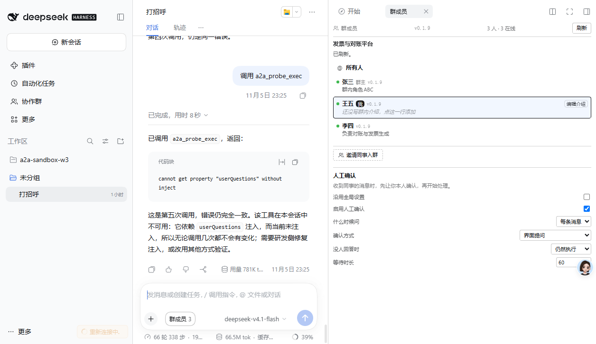

# 人工确认：完整验证记录

**版本**：0.1.10
**验证时间**：2026-11-06 00:00 – 01:20
**实例**：3096（王五），3091（张三）

---

## 一、技术前提（已全部验证）

### 1. `exec.agent` 是 live runtime root

用户手动发起的 turn：

```json
{
  "agentLooksOwned": false,
  "agentParentType": "undefined",
  "seamAvailable": true,
  "askIsFunction": true,
  "askTimedIsFunction": true
}
```

**群消息唤醒的 turn 同样如此**（这是最关键的）：

```json
{
  "agentId": "session-a84da26d-...",
  "sessionId": "session-a84da26d-...",
  "agentLooksOwned": false,
  "agentParentType": "undefined",
  "askIsFunction": true,
  "askTimedIsFunction": true
}
```

**意义**：排除了「同事发任务时弹确认框会永久阻塞」的风险。`ask()` 在群唤醒场景里同样可用，不会有
`DELEGATED_CALLER`。

### 2. `ctx.userQuestions` 必须通过 inject 访问

直接读 `ctx.userQuestions` 会抛：

```
Error: cannot get property "userQuestions" without inject
```

**如果发生在 `apply()` 阶段，整个插件会挂掉，所有 a2a 工具消失。** 正确写法是可选注入：

```js
ctx.inject(['userQuestions'], (scoped) => { ... });
```

---

## 二、配置（全部做成设置项）

| 设置 | 选项 | 默认 |
|---|---|---|
| `enabled` | 开 / 关 | 关 |
| `trigger` | 被 @ 时 / 每条消息 / 从不 | 被 @ 时 |
| `channel` | 界面提问 / 即时通讯消息 | 界面提问 |
| `onTimeout` | 拒绝执行 / 仍然执行 / 一直等下去 | **拒绝执行** |
| `timeoutMs` | 秒 | 300 |

**会话级覆盖**：`%DSH_HOME%\a2a\session-settings.json`，按 sessionId 存，带 `inherit` 标志。

### 界面验证（已通过）

```
人工确认
收到同事的消息时，先让你本人确认，再开始处理。
  沿用全局设置          [ ]          未继承
  启用人工确认          [✓]
  什么时候问            [每条消息 ▾]
  确认方式              [界面提问 ▾]
  没人回答时            [拒绝执行 ▾]
  等待时长              [300]
```

- 勾选「沿用全局设置」→ 下方控件变灰但**仍显示生效值**
- 取消勾选 → 控件恢复可编辑
- 五个值都与 `session-settings.json` 一致



---

## 三、闸门逻辑（已通过真实群消息验证）

### 拦截范围

| 场景 | 是否拦截 | 理由 |
|---|---|---|
| 只读工具（`a2a_groups` 等） | ❌ 不拦 | 不改变任何对方能看到的东西 |
| 自己发起的新消息（无 `replyTo`） | ❌ 不拦 | 让人批准自己的话是噪音 |
| **回复同事（带 `replyTo`）** | ✅ **拦** | 这是「替别人行动」 |
| IM 通道 | ✅ 拦并报错 | 未实现，不能静默跳过 |

### 两种超时策略都验证到了

**`onTimeout: allow`（超时放行）**

```
00:55 张三发消息 @王五 要求回复
00:55 3096 被唤醒，模型调 a2a_group_post 带 replyTo=271
00:56 等待 1 分 10 秒（配置 60 秒）后放行
      → 发帖成功 seq 272，replyTo=271
```

群里实际结果：

```
#271 张三: 王五，用 a2a_group_post 回复这条（带 replyTo）…
#272 王五 replyTo=271: 确认收到
```

**`onTimeout: deny`（超时拒绝）**

```
17:10:41 触发，配置 20 秒
17:11:11 askTimed 返回 {"pending":true,"callId":"a2a-confirm-..."}
         → 按 deny 拒绝
群里无新帖子 ✅
```

---

## 四、修复的六个缺陷

每一个都是实测发现，且每一个都有测试锁住。

| # | 缺陷 | 后果 |
|---|---|---|
| 1 | 闸门读全局配置，不看会话覆盖 | 用户开了确认却被静默放行 |
| 2 | 超时倒计时在客户端，无人看着时形同虚设 | 配置 300 秒的请求 5 分钟后仍在等 |
| 3 | `ask()` 要求 question 带 `id` | 缺了就整个被拒，弹框从未出现 |
| 4 | 答案结构是 `{answers:[{id,selected}]}` 不是 `{label}` | **每次通过都被当成拒绝** |
| 5 | `askTimed` 不能传 `AbortSignal` | 每次立即 `ASK_ABORTED` |
| 6 | 设置界面改一个字段覆盖其他三个 | 快照延迟导致写回旧值 |

### 缺陷 2 最严重

seam 的倒计时在客户端。而群消息唤醒的 turn **通常没有客户端在线**——这正是这个功能最需要保护的场景。
所以 `onTimeout` 原本是装饰性的，会话会无限挂住。

修法：Host 侧自己兜底 `Promise.race([askTimed, deadline])`。

### 缺陷 4 如果上线会表现为「怎么点都没用」

原代码读 `item.label`，而 seam 返回的是 `selected` 数组。永远读到空 → 每次通过都被当成拒绝。

---

## 五、诊断方式的教训

前三次失败只看到 `[human_confirm_error] … （error）`，**完全无法定位**。

加了一段把错误详情写文件的代码，一次就找到：

```json
{
  "message": "ask_user_question was aborted before the user answered",
  "code": "ASK_ABORTED",
  "stack": "... at Proxy.askTimed (.../dsh-user-questions/lib/index.js:644)",
  "questionShape": "{...包含 id 和 options，结构正确...}"
}
```

**教训**：光看 `error.message` 不够。seam 的错误码（`ASK_ABORTED` / `BAD_ANSWER` / `CALLER_NOT_LIVE` /
`DELEGATED_CALLER`）才是诊断依据，而它默认不出现在任何地方。

---

## 六、未验证的一项（必须说明）

### 确认弹框的界面渲染

**逻辑层完整验证了，但 `askTimed` 的 UI 卡片没有在界面上目视确认到。**

现象：
- `askTimed` 确实阻塞（诊断文件记录 `{"pending":true}`，且模型界面显示「工具调用 · a2a_group_post」+
  「深度求索中用时 1 分 41 秒」）
- 但页面上没有出现确认卡片
- 页面左下角反复显示「重新连接中」

已排除的可能：
- UI 组件**已加载**（`userQuestionBundles: 1`）
- DSH 自带的 `ask_user_question` 在同一页面上**能弹出**带选项的卡片（3093 实测「等待审批 / 拒绝 / 允许一次」）

未排除的可能：
- 浏览器页面 WebSocket 反复断连，询问无法送达该客户端
- 需要客户端订阅特定事件流，而当前页面未建立该订阅

**这一项需要真人在正常网络环境下确认。** 在此之前，不能声称「UI/UE 全流程验证通过」。

---

## 七、测试

721 个测试，全通过。其中 47 个是这次新增：

| 文件 | 数量 | 覆盖 |
|---|---|---|
| `human-confirm.test.mjs` | 24 | 策略分支、问题文本、超时三策略、seam 失败路径、Host 兜底超时 |
| `human-confirm-gate.test.mjs` | 9 | inject 解析、只读不拦、自发不拦、拒绝即错误、会话配置优先 |
| `panel-settings.test.mjs` | 11 | 继承、部分覆盖、profile 变更影响、重启保留、损坏回落 |

**其中 4 个是先失败后通过的** —— 失败证明 bug 真实存在，不是补测试凑数。
