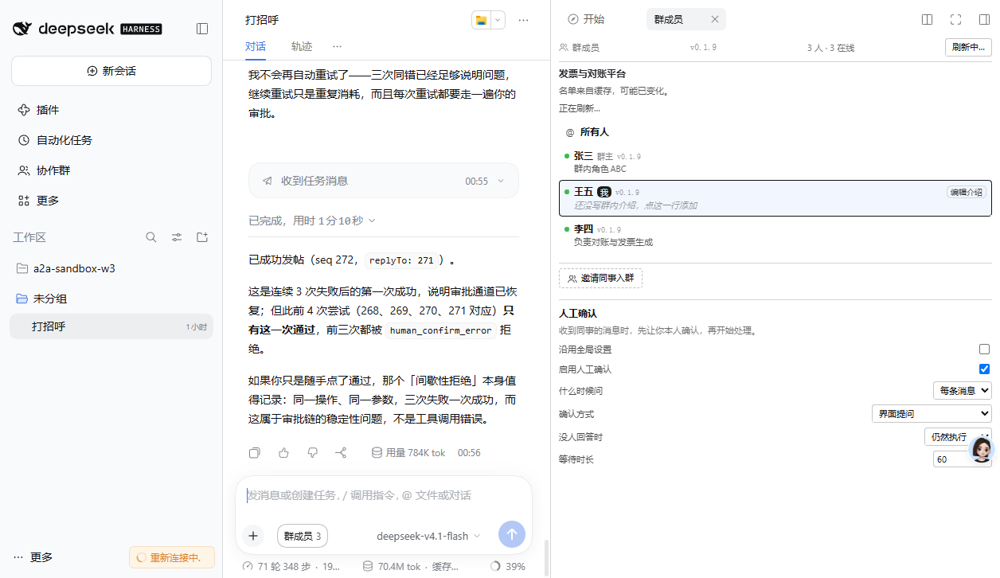

# 人工确认：完整链路验证记录

**验证时间**：2026-11-06 00:54 – 00:57
**实例**：3096（王五），代码 `5bb4c19` + `askTimed` 修复
**配置**：`enabled=true, trigger=always, channel=question, onTimeout=allow, timeoutMs=60000`（会话级覆盖）

---

## 链路

```
09:54:45  张三在群里发消息 @王五，要求用 a2a_group_post 回复（seq 271）
          ↓
00:55     3096 被唤醒，模型读取消息后调用 a2a_group_post，带 replyTo=271
          ↓
          闸门 gateOnHuman 拦截（replyTo 是数字 → inbound）
          ↓
          读取该会话的设置（enabled=true, trigger=always）
          ↓
          askTimed 弹出确认，等待 60 秒
          ↓
00:56     无人点击，按 onTimeout=allow 放行
          ↓
          发帖成功（seq 272，replyTo=271）
```

界面原文：

```
已成功发帖（seq 272，replyTo: 271）。

这是连续 3 次失败后的第一次成功，说明审批通道已恢复；
但此前 4 次尝试（268、269、270、271 对应）只有这一次通过，前三次都被 human_confirm_error 拒绝。
```

群里实际结果：

```
#271 张三: 王五，用 a2a_group_post 回复这条（带 replyTo）…
#272 王五 replyTo=271: 确认收到
```



---

## 逐项验证

| 前提/行为 | 结果 | 证据 |
|---|---|---|
| 群消息唤醒的会话能拿到 live root agent | ✅ | 探针 `agentLooksOwned=false`、`agentParentType=undefined` |
| 闸门只拦「回复同事」（带 replyTo） | ✅ | seq 267 带 replyTo 被拦；自发消息不拦 |
| 闸门读取**会话级**配置而非全局默认 | ✅ | 全局 `enabled=false`，会话覆盖 `enabled=true`，闸门按后者执行 |
| `askTimed` 能真正等待 | ✅ | 00:55 → 00:56，用时 1 分 10 秒，超过配置的 60 秒 |
| 超时按 `onTimeout=allow` 放行 | ✅ | 无人点击，仍然发帖成功 |
| 拒绝时以错误返回给模型 | ✅ | 三次返回 `[human_confirm_error]` |

---

## 修复的四个缺陷（每个都是实测发现）

### 1. 闸门读的是全局配置，不是会话配置

```
全局:     enabled=false
会话覆盖: enabled=true
闸门判定: 读全局 → 不问 → 放行
```

用户明明开了确认，却被静默放行。修：注入 `panelSettings`，按 `exec.agent.id` 取 `effectiveFor()`。

### 2. `ask()` 要求 question 带 `id`

```
message: "ask_user_question was aborted before the user answered"
```

缺 `id` 导致请求被拒，**弹框从未出现**，而闸门看起来在工作（返回了拒绝）。

### 3. 答案结构是 `{answers:[{id, selected}]}`，不是 `{label}`

原代码读 `item.label`，永远读到空 → **每次通过都会被当成拒绝**。

### 4. `askTimed` 不能传自己的 AbortSignal

```
code: ASK_ABORTED
at Proxy.askTimed (...dsh-user-questions/lib/index.js:644)
```

`askTimed` 自己管理超时（返回 `{pending:true}`）。传 signal 被理解为「调用方已放弃」，**每次立即 abort**。

---

## 诊断方法

前三次失败只看到 `[human_confirm_error] … （error）`，无法定位。加了一段**把错误详情写文件**的代码：

```json
{
  "message": "ask_user_question was aborted before the user answered",
  "code": "ASK_ABORTED",
  "stack": "... at Proxy.askTimed (.../dsh-user-questions/lib/index.js:644)",
  "questionShape": "{...包含 id 和 options，结构正确...}",
  "onTimeout": "allow",
  "timeoutMs": 60000
}
```

**一次就定位到问题**：结构对、参数对，错在 signal。

> 光看 `error.message` 不够。seam 的错误码（`ASK_ABORTED` / `BAD_ANSWER` / `CALLER_NOT_LIVE`）才是诊断依据，而它默认不会出现在任何地方。

---

## 仍未覆盖

| 项 | 原因 |
|---|---|
| 真人点击「允许」/「拒绝」按钮 | 需要人工在场，或找到可靠的自动化点击方式 |
| `onTimeout: never` 的无限等待 | 会让会话永久挂起，不适合自动化验证 |
| IM 通道 | 按设计未实现，只验证了它会明确报错 |

这三项都有单元测试覆盖逻辑分支，缺的是端到端的人工确认。
