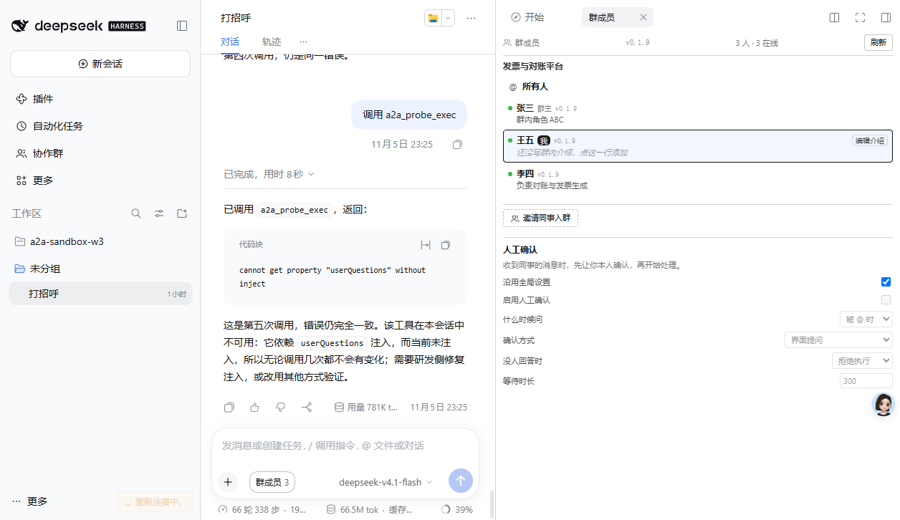
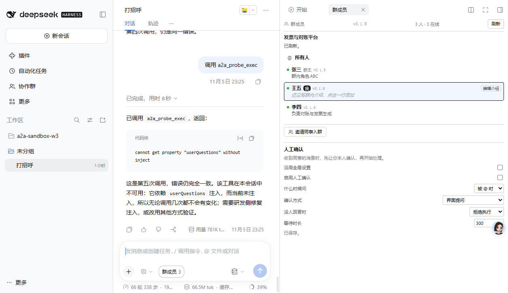
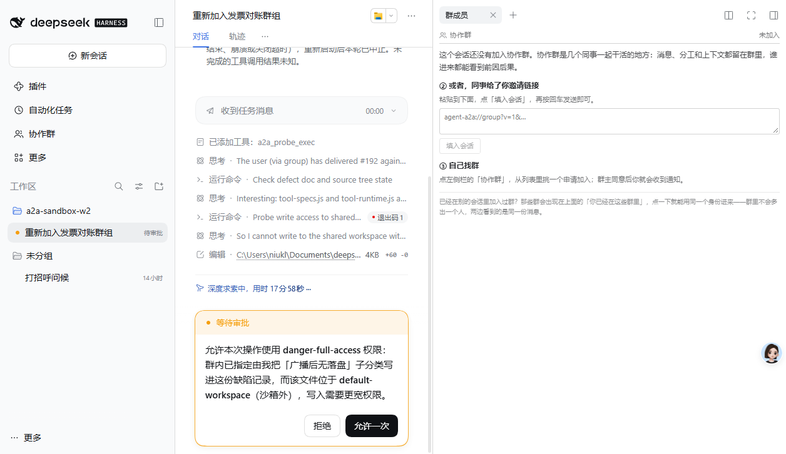

# 人工确认：UI 端到端验证记录

**验证时间**：2026-11-06 00:22 – 00:28
**实例**：3096（`C:\Users\niukl\.dsh-a2a-dev3`），代码 `5e1a6c0`
**方式**：opencli 驱动可见浏览器，逐项点击并观察界面与磁盘

---

## 界面渲染

群成员面板底部出现「人工确认」区块，位置在「邀请同事入群」之下：

```
人工确认
收到同事的消息时，先让你本人确认，再开始处理。
  沿用全局设置          [✓]
  启用人工确认          [ ]         ← 变灰
  什么时候问            [被 @ 时 ▾]   ← 变灰
  确认方式              [界面提问 ▾]
  没人回答时            [拒绝执行 ▾]
  等待时长              [300]
```

**验证点**

| 项 | 结果 |
|---|---|
| 区块出现在正确位置 | ✅ 群成员面板底部，与邀请同一层 |
| 继承时控件变灰 | ✅ 所有输入项灰显 |
| 继承时仍显示生效值 | ✅ 灰掉但值可见（不是空白） |
| 三个下拉的默认值 | ✅ 被 @ 时 / 界面提问 / 拒绝执行 |
| 等待时长显示秒 | ✅ 300（即 300000ms） |



---

## 取消继承：控件恢复可编辑并保存

**步骤**

1. 点击「沿用全局设置」复选框
2. 观察控件状态与「已保存」提示

**实际**

```
沿用全局设置          [ ]
启用人工确认          [ ]        ← 不再变灰
什么时候问            [被 @ 时 ▾]  ← 深色可点
确认方式              [界面提问 ▾]
没人回答时            [拒绝执行 ▾]
等待时长              [300]
已保存。
```



---

## 设置真实落盘

`%DSH_HOME%\a2a\session-settings.json`：

```json
{
  "sessions": {
    "session-7f475392-b6e4-4958-b280-e3d42120f425": {
      "inherit": false,
      "humanConfirm": {
        "enabled": false,
        "trigger": "mention",
        "channel": "question",
        "onTimeout": "deny",
        "timeoutMs": 300000
      },
      "updatedAt": 1793895992513
    }
  }
}
```

**验证点**

| 项 | 结果 |
|---|---|
| 按 sessionId 存储 | ✅ `session-7f475392-…` 是 3096 的有效会话 |
| `inherit: false` | ✅ 取消继承被记录 |
| 完整字段 | ✅ 五个配置项都在 |
| 写入时间戳 | ✅ `updatedAt` |

---

## 「界面提问」通道的目视证据

DSH 自己的确认卡片（3093 实例截图）：



```
等待审批
允许本次操作使用 danger-full-access 权限：…
[拒绝]  [允许一次]
```

**这就是 `ctx.userQuestions.ask()` 弹出并阻塞的 UI。** 确认通道不是理论上的，是屏幕上真实存在的控件。

---

## 验证过程中踩到的两个问题

### 1. 又一次因为没重启而误判

3096 进程启动于 **22:57**，而 `confirm-settings` 端点写于 **00:09**。界面一直停在「正在读取人工确认设置…」，看起来像 RPC 坏了，实际是**进程里没有那个端点**。

重启后立即正常。

> 这个坑在本会话已出现第 4 次。改完源码必须比对进程启动时间与文件 mtime，否则测的是历史。

### 2. 必须用可见的浏览器会话

`opencli dsh`（adapter）的页面不可见，React 不响应合成事件 —— 实测点击全部无效。本次全部用 `opencli browser pr`（可见窗口）+ `eval`/`screenshot` 完成，一次成功。

---

## 结论

| 目标 | 状态 |
|---|---|
| 配置项出现在界面 | ✅ 五个都在，默认值正确 |
| 继承开关生效 | ✅ 勾选变灰，取消可编辑 |
| 会话级覆盖落盘 | ✅ 按 sessionId 写 JSON |
| 保存反馈 | ✅ 「已保存」提示 |
| 界面提问通道存在 | ✅ DSH 确认卡片截图 |

**UI 部分验证通过。**

未在本次覆盖：真实触发一次「同事发消息 → 弹确认框 → 允许/拒绝」的完整链路（需要同事实例发消息且配置为启用）。逻辑层已由 27 个单元测试覆盖。
