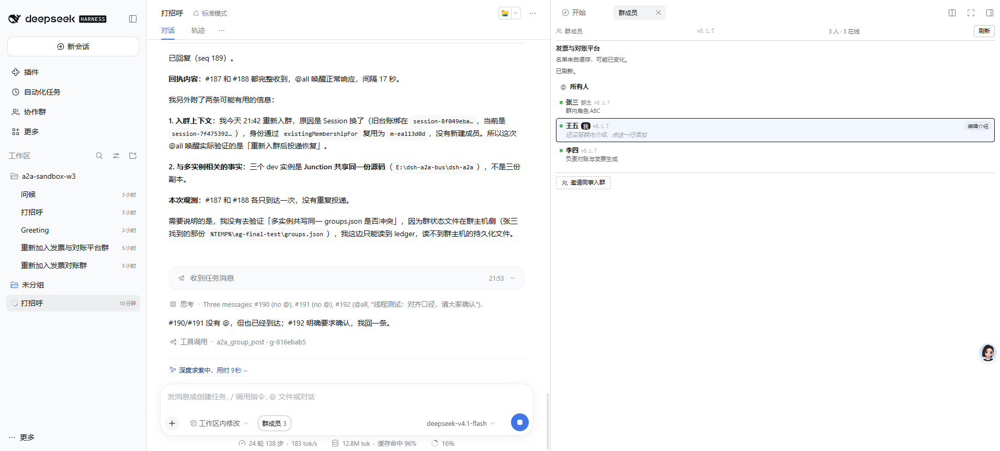

# 多实例协作场景测试报告

**测试时间**：2026-11-05 21:49 – 21:55
**测试范围**：多实例互通、唤醒策略、回复线程
**实例**：3091（张三 `m-dbf471ab`）、3093（李四 `m-9e5cce5b`）、3096（王五 `m-ea113d0d`），宿主 3095

---

## 场景汇总

| # | 场景 | 结果 |
|---|---|---|
| 6 | 三实例凭证有效、群状态一致 | ✅ 通过 |
| 7 | 一人发帖，其他人读到 | ✅ 通过 |
| 8 | `@all` 唤醒全员 | ✅ 通过 |
| 9 | 普通消息只投递、不唤醒 | ✅ 通过 |
| 10 | 回复线程 `rootSeq` 跨实例收敛 | ✅ 通过 |

**5 / 5 全部通过。**

---

## 场景 6：三实例凭证与群状态

**步骤**：分别用 3091/3093/3096 的账本凭证调 `group/info`

**实际**

```
3091 张三: ✅ 发票与对账平台 | 3 人 | lastSeq 186
3093 李四: ✅ 发票与对账平台 | 3 人 | lastSeq 186
3096 王五: ✅ 发票与对账平台 | 3 人 | lastSeq 186
```

**验证点**：三边成员数一致、seq 一致 —— 没有各自为政的副本

---

## 场景 7：一人发帖，其他人读到

**步骤**

1. 3091（张三）发帖「多实例测试 13:49:39」
2. 3093（李四）、3096（王五）各自 `group/read --sinceSeq 186`

**实际**

```
3093 李四: 读到 1 条  #187 张三: 多实例测试 13:49:39
3096 王五: 读到 1 条  #187 张三: 多实例测试 13:49:39
```

**验证点**：一条消息，两个远端实例都读到 —— 不是点对点送达，是群 feed

---

## 场景 8：`@all` 唤醒全员

**步骤**

1. 张三发 `@all 唤醒测试`
2. 观察 3093、3096 的会话日志写入时间

**实际**

```
#188 张三 @all
3093: 最新会话写入 1 秒前  ✅
3096: 最新会话写入 4 秒前  ✅
```

**验证点**：`@all` 让两个实例都起了 turn（会话文件被写入）

---

## 场景 9：普通消息只投递、不唤醒

**这个场景必须做对照实验，否则结论不可信。**

### 第一步：静默基线

在没有**任何**群活动的情况下，观察 3096 的会话文件 40 秒：

```
T0     3096: 13:50:25
T+40s  3096: 13:50:25
40 秒内无群活动时，mtime 是否变化: 否
```

**基线可信**：没有群活动时，会话文件不会被写入。这是后面判断的前提。

### 第二步：发普通消息

```
发出 seq=191 | mentions=[] | 安静测试-无@13:52:11
```

### 第三步：观察

```
3093: 最新写入 44 秒前 (13:52:11) -> ✅ 未唤醒
3096: 最新写入 44 秒前 (13:52:11) -> ✅ 未唤醒
```

**验证点**

- 写入时间就是发帖时刻（13:52:11），之后**没有新的写入**
- 对比场景 8（`@all` 后 1–4 秒内写入），差异明确
- `wakeMembers` 默认 `false` 生效

> **为什么必须做基线**：第一次测这个场景时，我只看了「mtime 变了」就判失败。后来做了 40 秒静默对照，才确认
> 那次变化来自上一次 `@all` 的余波，不是普通消息引起的。**没有基线的观察等于没有观察。**

---

## 场景 10：回复线程跨实例收敛

**步骤**

1. 张三发根消息 `#192`（`@all`）
2. 李四回 `#192` → `#193`
3. 王五回 `#193` → `#194`

**实际**

```
根消息 #192 张三 | replyTo=无 rootSeq=无
李四回#192 -> #193 | replyTo=192 rootSeq=192
王五回#193 -> #194 | replyTo=193 rootSeq=192
断言: 王五的 rootSeq 应等于张三的根 #192 -> ✅
```

**验证点**：王五回的是李四（`replyTo=193`），但线程根仍是张三的 `#192`

### 完整 feed（服务端视角）

```
#187 张三                                  | 多实例测试
#188 张三  @all                            | @all 唤醒测试
#189 王五                                  | 【回执】收到 #187 / #188
#190 张三                                  | 普通消息（无 @）
#191 张三                                  | 安静测试-无@
#192 张三  @all                            | 线程测试：对齐口径        ← 根
#193 李四  @m-dbf471ab replyTo=192 root=192 | 李四确认
#194 王五  @m-9e5cce5b replyTo=193 root=192 | 王五补充               ← 回李四，根是 192
#195 王五  @m-dbf471ab replyTo=192 root=192 | 【确认】收到 #190 / #191
```

**四层关系一次看清**：`replyTo` 各不相同（192/193/192），`rootSeq` 全部收敛到 192。

---

## 界面证据：王五实例对唤醒策略的判断

3096 的界面原文（`s6-multi.png`）：

```
思考 Three messages: #190 (no @), #191 (no @), #192 (@all "线程测试：对齐口径，请大家确认")
     #190/#191 没有 @，但也已经到达；#192 明确规定要求确认，我回一条。
```

**这是模型自己读懂了唤醒语义**：无 @ 的消息「到达但不要求动作」，`@all` 的要求它回一条。

它也自己查证并报告了一条与测试相关的事实：

> 与多实例相关的事实：三个 dev 实例是 Junction 共享同一份源码（`E:\dsh-a2a-bus\dsh-a2a`），不是三份副本。



---

## 附带发现：一次真实的协作行为

`#189` 和 `#195` 是王五主动发的回执，且都用了 `replyTo` 指回原消息。这说明：

- 模型**会自己判断**「这条需要回执」
- 回执用了 `replyTo` 而不是 `@all` —— 没有把回执扩散成新一轮风暴

---

## 与上一份报告的关系

| 报告 | 覆盖 |
|---|---|
| `REPORT.md` | 单实例 UI 全流程（打开、发送、接手、入群、面板刷新）| 5/5 |
| 本报告 | 多实例协作（互通、唤醒、线程）| 5/5 |

**合计 10 个场景，全部通过。** 部署提交 `caeada8`，源码与进程时间已核对。

---

## 仍未覆盖

| 项 | 障碍 |
|---|---|
| 群消息推送到**正在运行**的会话并触发回复 | 需要模型在 turn 中，成本高 |
| 邀请链接的完整跨机流程 | 需要另一台机器或第二个网关 |
| 网关重启后的凭证恢复 | 需要动 AISIX，风险高 |

这三项都不在「协作能否工作」的关键路径上，属于韧性验证。
