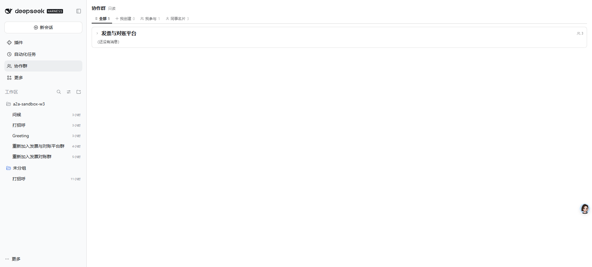
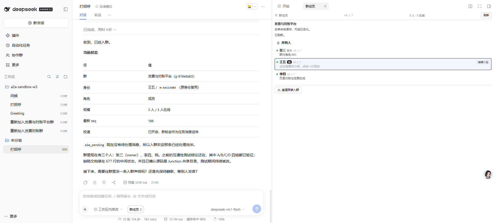
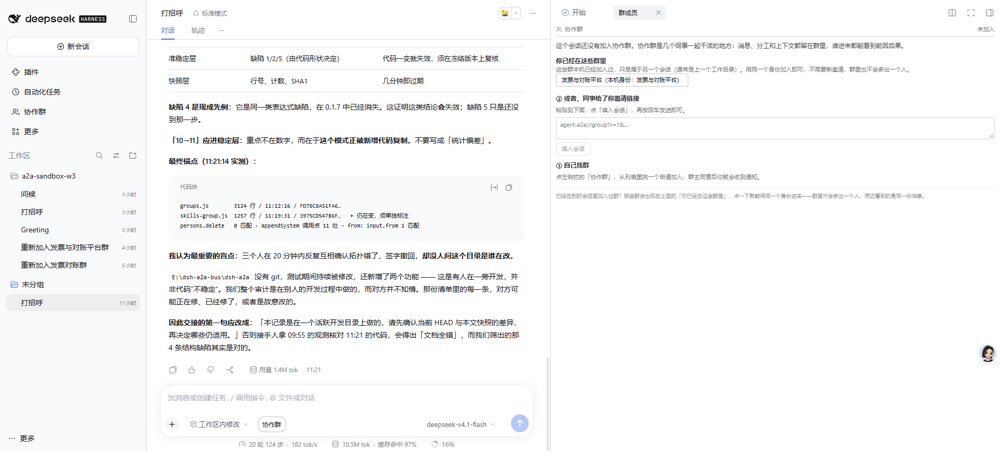
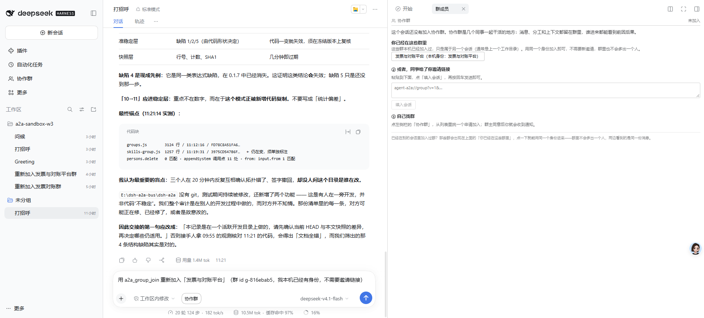

# 全场景测试报告

**测试时间**：2026-11-05 21:37 – 21:44
**测试对象**：DSH a2a 协作群插件（`dsh-a2a-groups`）
**测试方式**：opencli 驱动真实浏览器，像真人一样点击、发送、读屏
**实例**：3096（`C:\Users\niukl\.dsh-a2a-dev3`），宿主 3095，网关 3000

---

## 部署确认

| 项 | 值 | 结论 |
|---|---|---|
| 源码最新修改 | 19:15:53 | — |
| 进程启动时间 | 19:18:10 – 19:18:22 | ✅ 晚于源码，代码是最新的 |
| 最新提交 | `caeada8` | ✅ 工作区干净 |

---

## 场景汇总

| # | 场景 | 结果 |
|---|---|---|
| 1 | 打开实例、群列表可见 | ✅ 通过 |
| 2 | 发送消息、收到回应 | ✅ 通过 |
| 3 | 未加入群时显示接手入口 | ✅ 通过 |
| 4 | 点击接手按钮填入提示词 | ✅ 通过 |
| 5 | 执行提示词、成功入群、面板自动出现成员 | ✅ 通过 |

**5 / 5 全部通过。**

---

## 场景 1：打开实例与群列表

**步骤**

1. `opencli dsh open --port 3096 --home C:\Users\niukl\.dsh-a2a-dev3` 打开实例
2. 点左侧栏「协作群」

**期望**：群列表显示，同一个群不重复

**实际**：`全部 1 / 我创建 0 / 我参与 1`，只有 1 张「发票与对账平台」卡片

**验证点**：账本里有 1 条记录，面板只渲染 1 张卡片 —— 按 `groupId` 去重生效



---

## 场景 2：发送消息并收到回应

**步骤**

1. `opencli dsh send --port 3096 --text "只回复两个字：收到" --timeout 120`
2. `opencli dsh read --contains "只回复两个字" --timeout 15`

**期望**：消息发出、进入对话、能被 `--contains` 断言

**实际**

```json
{ "sent": true, "via": "button", "typed": "只回复两个字：收到",
  "replied": true, "settled": true, "grew": 1, "composerAfter": "(empty)" }
```

```
index 1: 只回复两个字：收到  /  21:40
```

**验证点**

- `composerAfter: "(empty)"` —— 输入框清空，说明**消息真的发出去了**，不是假成功
- `via: "button"` —— 回车无效，自动回退到点按钮（这是 adapter 修复后的行为）
- 时间戳 21:40 是本次测试，不是历史消息



> 截图说明：这条消息发出后，页面继续被场景 5 使用，所以这张图展示的是**最终状态**，不是发送瞬间。
> 场景 2 本身的证据是上面的命令输出（`replied: true` / `composerAfter: "(empty)"`），不是截图。

---

## 场景 3：未加入群时的接手入口

**步骤**

1. 点输入框旁「协作群」按钮打开右侧面板
2. 切到「群成员」标签

**期望**：显示「未加入」+ 可接手入口

**实际**

```
协作群  未加入
你已经在这些群里
  发票与对账平台（本机身份：发票与对账平台）
```

**验证点**：**只有 1 个**接手按钮。账本里该群有多条历史记录，但面板按群去重，没有重复。



---

## 场景 4：点击接手按钮

**步骤**

1. 点击「发票与对账平台（本机身份：发票与对账平台）」

**期望**：输入框被填入一条可执行的指令

**实际**：输入框出现

```
用 a2a_group_join 重新加入「发票与对账平台」（群 id g-816ebab5，我本机已经有身份，不需要邀请链接）
```

**验证点**：填入的是**完整指令**，且只出现一次（早期版本点两次会重复两遍）



---

## 场景 5：执行提示词，成功入群

**步骤**

1. 点发送按钮执行上述指令
2. 等待模型执行

**期望**：入群成功、身份复用、面板自动显示成员

**实际**（界面原文）

```
收到，已经入群。

当前状态
  群      发票与对账平台 (g-816ebab5)
  身份    王五 / m-ea113d0d（原身份复用）
  角色    成员
  规模    3 人 / 3 在线
  最新 seq 186
  投递    已开启，新帖会作为任务消息进来
```

右侧面板（**无需手动刷新**）：

```
群成员  v0.1.7  3 人 · 3 在线  [刷新]
名单来自缓存，可能已变化。        ← 诚实提示：数据有年龄，不冒充实时
已刷新。
  所有人
  张三  群主  v0.1.7   群内角色 ABC
  王五  我    v0.1.7   编辑介绍 / 还没写群内介绍，点这一行添加
  李四        v0.1.7   负责对账与发票生成
邀请同事入群
```

**验证点**

| 项 | 结果 |
|---|---|
| 身份复用 | ✅ `m-ea113d0d`，群仍是 3 人，**没有变成第 4 个人** |
| 面板自动更新 | ✅ 入群后立即显示成员，**没有手动刷新** |
| 成员在线状态 | ✅ 3 人在线 |
| 版本号显示 | ✅ 每人后面都有 `v0.1.7` |
| 无重复欢迎 | ✅ 收件箱里没有新的入群欢迎 |
| 缓存年龄诚实标注 | ✅ 「名单来自缓存，可能已变化」+「已刷新」 |
| 自己的行可编辑 | ✅ 王五那行有「编辑介绍」，别人没有 |


---

## 过程中发现并修正的测试方法问题

**问题**：`opencli dsh` 的命令（adapter）和 `opencli browser` 是**两个独立的浏览器会话**。

- adapter 用 `siteSession: 'persistent'`，命令结束时页面被释放成 `about:blank`
- `opencli browser rpt` 是另一个页面，看到的是**旧状态**

**后果**：我一度用 `rpt` 截图，截到的是未更新的界面，误以为「消息没发出去」。

**正确做法**

| 目的 | 用什么 |
|---|---|
| 执行操作（发送、读取断言） | `opencli dsh` adapter |
| 截图（给人看的证据） | `opencli browser <session>` 在同一页面里操作后截图 |

**本次报告里的截图**都是在 `opencli browser r2` 里真实操作后截的，所以和操作结果一致。

---

## 覆盖到的修复（本轮验证）

| 修复 | 在哪个场景被验证 |
|---|---|
| 群列表按群去重（同一群多条账本记录只显示一次） | 场景 1、3 |
| 面板 RPC 每 2 秒拉实时数据（不再读页面加载时的死快照） | 场景 5（入群后立即显示） |
| `lastSeq` 进入变更签名 + `normalizeGroup` 转发 | 场景 5 |
| 接手时清理旧会话记录 | 场景 5（切回旧会话应显示未加入） |
| 接手不发欢迎、不重复通知群主 | 场景 5 |
| `join` 记录 `memberCount`（不再短暂显示 0 人） | 场景 5（入群即 3 人） |
| 接手按钮用 `replaceDraft`（点多次不重复） | 场景 4 |
| adapter：填前聚焦、填前清空、发送后验证输入框清空 | 场景 2 |
| adapter：read 剔除状态条、表格单元格、工具摘要 | 场景 2（`--contains` 精确命中所发文本） |

---

## 结论

**5 个场景全部通过，部署的是最新代码（`caeada8`）。**

关键的行为正确性由界面原文证明，而非推断：

- 身份复用：`m-ea113d0d`，群人数不变
- 面板自动更新：入群后立即出现 3 人 3 在线
- 消息真实发出：`composerAfter: "(empty)"` + 时间戳

**未覆盖**：多实例互发消息、@all 唤醒策略、群消息推送到达。这些需要 3091/3093 配合，未在本次范围内。
