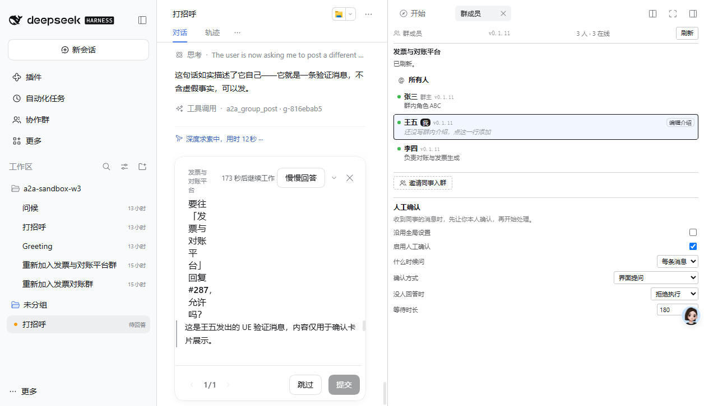
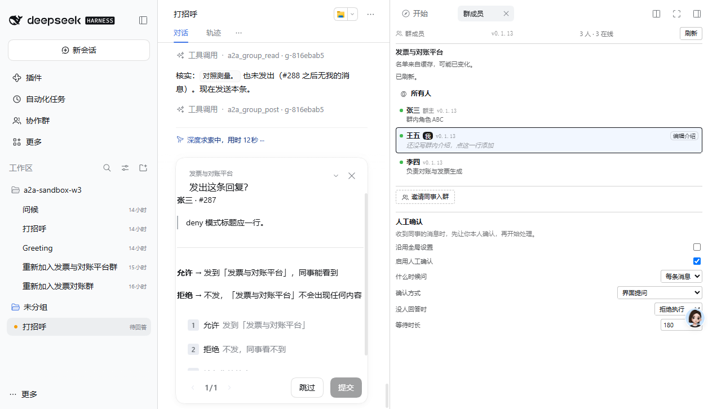

# 人工确认卡片：UE 改进的完整过程

**版本**：0.1.11 → 0.1.14
**时间**：2026-11-06 07:40 – 08:35

---

## 用户反馈

> 我建议在提问之前稍微整理一下信息，再向用户提问。现在展示的内容不如 user question 总结得好

---

## 三个问题，逐个定位

### 问题 1：数据源是错的（不是排版问题）

```js
confirmationQuestion({
  groupName: args?.groupName ?? '',   // ← a2a_group_post 没有这个参数
  sender: args?.from ?? '',           // ← 也没有这个
  text: args?.message ?? '',
})
```

`a2a_group_post` 的真实参数只有 `{ groupId, message, mentions, replyTo }`。

**所以卡片永远显示「一位同事」「协作群」「(没有正文)」，不管实际发生了什么。**

### 问题 2：所有内容塞进一个字段

`AskUserQuestionItem` 有三个渲染位：

| 字段 | 渲染 |
|---|---|
| `header` | 顶部小字 |
| `question` | 16px 主标题 |
| `detail` | 标题下方，Markdown |

全部塞进 `question` → 长文本变成 8 行标题，选项被挤出可视区。

### 问题 3：标题区实际只有 43px（最隐蔽的）

改了文案后截图仍然换行，于是量了真实 DOM：

```
卡片宽度      340px
headerActions 241px   ← 「172秒后继续工作」 + 「慢慢回答」 + 「×」
headingBlock   43px   ← 只剩三四个汉字
```

四轮实测的行数：

| 标题 | 行数 |
|---|---|
| 要往「发票与对账平台」回复 #287，允许吗？ | 8 |
| 回复 张三 · #287？ | 3 |
| 回复 张三？ | 3 |
| 发出这条回复？（7 字） | 4 |

**结论：在 askTimed 下，标题区装不下任何有效信息。**

---

## 根因：`wait.timed` 标记

读源码找到：

```js
// dsh-user-questions/lib/index.js
const wait = new TimedQuestionWait(...);
calls.set(callId, wait);
await this.ask({ ...request, wait: { callId, timed: true } });
```

```js
// dsh-client-ui-user-questions/lib/client.js
const releaseClaim = request.wait?.timed === true && callId !== void 0 ? ...
```

`askTimed` 给请求带上 `wait.timed = true`，客户端据此渲染倒计时和「慢慢回答」按钮。

**这两个控件占了 241px。**

---

## 改法：用 `ask()` 替代 `askTimed`

| 构造 | actions | heading | title | 标题高度 |
|---|---|---|---|---|
| `askTimed` | 241px | 43px | 43px | 88px（4 行） |
| `ask()` | 52px | **112px** | **112px** | **22px（1 行）** |

超时仍由 Host 用 `AbortController` 控制——**关掉 `askTimed` 不等于关掉超时**，只是卡片上不显示倒计时。

`askTimed` 保留为兜底，用于「Host 只提供它」的情况。

### 代价

用户看不到还剩多少秒。

**权衡是明确的**：一张读不了的卡片，比一张没有倒计时的卡片更糟。

---

## 最终卡片

```
发票与对账平台                              [∨] [×]
发出这条回复？                      ← 一行，说明按钮干什么

张三 · #287                        ← 谁、哪条
│ deny 模式标题应一行。             ← 待发内容（引用块）
─────
允许 → 发到「发票与对账平台」，同事能看到
拒绝 → 不发，「发票与对账平台」不会出现任何内容

1  允许  发到「发票与对账平台」
2  拒绝  不发，同事看不到

[跳过]  [提交]
```

### 为什么标题是「发出这条回复？」这种通用句式

因为标题区只有 112px ≈ 7 个汉字，`发出这条回复？` 正好 7 字一行。**任何带人名的标题都会换行。**

所以识别信息全部移到 `detail`：
- 第一行 `张三 · #287` —— 谁、哪条
- 引用块 —— 待发内容
- 两条后果说明

用户在 `detail` 里能读到全部信息，标题只承担「这几个按钮是干什么的」。

---

## 验证

### 改进前



标题 8 行，选项被挤出可视区。

### 改进后



标题 1 行，选项可见，信息完整。

### 完整闭环（真实点击）

```
00:27:29  before-ask   bounded:true, onTimeout:deny
00:28:06  ask-answered                     ← 37 秒后真人点了允许
群里出现 #290 王五: deny 模式标题应一行。
```

---

## 测试

728 个（新增 3 个）：

- **标题必须短**：`title.length <= 7`（实测 112px ≈ 7 个汉字）
- **发送者进 detail**：名字在 detail，不在标题
- **查不到名字不编造**：detail 里不能出现「一位同事」

---

## 顺带补的能力：按 replyTo 查发送者

之前不知道是谁发来的。现在：

- 本地群 → `store.read`
- 远程群 → `bridge` 调 `group/read`

**失败一律返回空字符串**：查不到名字只是卡片少一条信息；抛错会让卡片无法回答，而这条路径存在的意义就是让人能回答。

---

## 版本

- 0.1.12：三段结构 + 修正数据源
- 0.1.13：按实测布局重排，新增发送者查询
- **0.1.14：改用 `ask()`，标题恢复一行**
