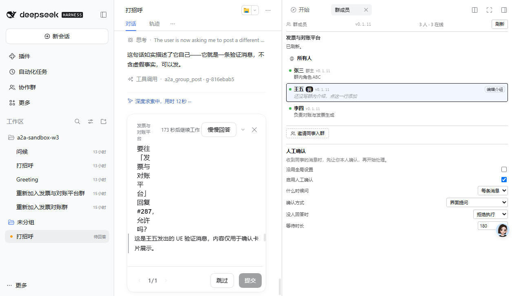
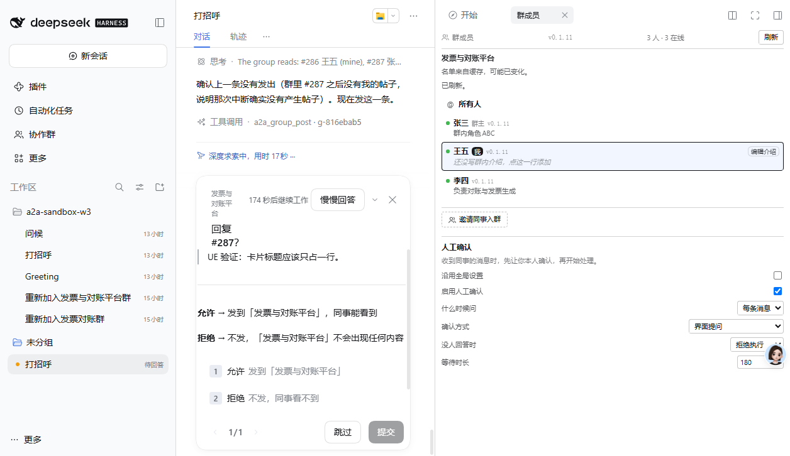

# 人工确认卡片：UE 改进前后对比

**版本**：0.1.11 → 0.1.12
**时间**：2026-11-06 07:40 – 08:05

---

## 用户反馈

> 我建议在提问之前稍微整理一下信息，再向用户提问。现在展示的内容不如 user question 总结得好

---

## 诊断：两个问题

### 问题 1：数据源是错的

gate 里传给卡片的字段：

```js
confirmationQuestion({
  groupName: args?.groupName ?? '',   // ← 这两个字段在 a2a_group_post 的参数里不存在
  sender: args?.from ?? '',           // ←
  text: args?.message ?? '',
})
```

而 `a2a_group_post` 的真实参数只有：

```js
{ groupId, message, mentions, replyTo }
```

**所以卡片永远显示「一位同事」「协作群」「(没有正文)」**，不管实际发生了什么。这不是排版问题，是信息根本没拿到。

### 问题 2：所有内容塞进一个字段

`AskUserQuestionItem` 有三个渲染位：

| 字段 | 渲染 |
|---|---|
| `header` | 顶部小字（eyebrow） |
| `question` | 16px 主标题 |
| `detail` | 标题下方，Markdown |

我把全部内容都放进了 `question`，于是：

- 22 字的标题在窄卡片里被压成 **8 行 × 3 个字**
- 待发内容被截断
- **两个选项被挤出可视区**

---

## 改进

### 三段结构

```
header    发票与对账平台          ← 顶部小字，位置感
question  回复 #287？             ← 一行决策
detail    > UE 验证：卡片标题应该只占一行。
          ───
          允许 → 发到「发票与对账平台」，同事能看到
          拒绝 → 不发，「发票与对账平台」不会出现任何内容
```

### 五个具体决定

1. **群名移到 header，标题不再重复**
   群名在标题里占的是卡片最贵的空间，而 header 本来就是放它的地方。

2. **标题从 22 字压到 8 字**
   「要往「发票与对账平台」回复 #287，允许吗？」→「回复 #287？」

3. **展示「要发出去的回复」，不是「收到的消息」**
   用户要批准的是这句会出现在群里的话，这才是判断依据。

4. **原文用 Markdown 引用块**
   `> ` 前缀逐行加，多行消息也不会断开引用。

5. **选项说明写后果，不重复标签**
   「允许 / 拒绝」本身没有信息量。改成「发到「发票与对账平台」」/「不发，同事看不到」。

### 长内容有可见的截断标记

```js
const clipped = body.length > 900
  ? `${body.slice(0, 900)}\n\n…（还有 ${body.length - 900} 字未显示）`
  : body;
```

静默截断会让用户批准自己没看到的内容。

---

## 验证

### 改进前



标题被压成 8 行，选项不可见。

### 改进后



```
发票与对账平台                        会一直等你回答  [慢慢回答] [×]
回复 #287？

│ UE 验证：卡片标题应该只占一行。

允许 → 发到「发票与对账平台」，同事能看到
拒绝 → 不发，「发票与对账平台」不会出现任何内容

1  允许  发到「发票与对账平台」
2  拒绝  不发，同事看不到

[跳过]  [提交]
```

标题 1 行、内容完整、两个选项都在。

### 点击验证

```
00:01:16  {"pending":false,"answers":[{"id":"a2a-human-confirm","selected":["允许"]}]}
群里出现 #288 王五: UE 验证：卡片标题应该只占一行。
```

---

## 测试

725 个（新增 2 个）：

- **标题必须短**：`title.length <= 14`，超过就会在窄卡片里换行
- **群名不重复**：header 里有群名时，标题不再包含

原有断言改成检查新结构：内容在 `detail` 而不是 `question`。

---

## 一个操作细节（记录了排查过程）

CDP 点击选项时，`hit: "target"` 但提交后卡片仍报「请选择一个选项」。原因是我用 React fiber
直接调 `onClick` 传了不完整的合成事件，选中状态没进 state。

**用 `opencli browser click` 的 CDP 点击才真正生效**（先点选项，再点提交，两次都要用 CDP）。

---

## 仍然存在的限制（未变）

群消息唤醒的 turn 里卡片不显示（`scopeOf(owner)` 认不出，DSH 架构限制）。这次改的是**卡片显示时
长什么样**，不是**什么时候显示**。
